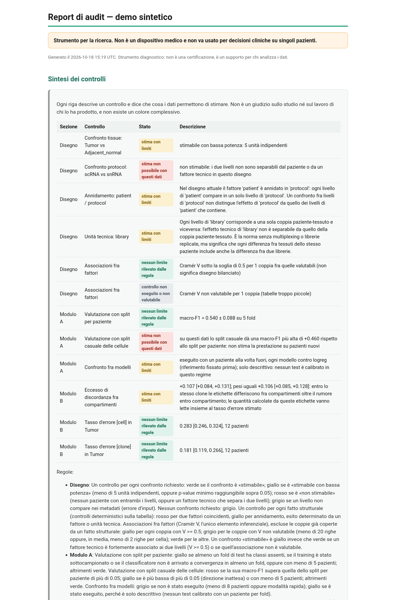

# genomic-audit

> **Strumento per la ricerca. Non è un dispositivo medico e non va usato per decisioni cliniche
> su singoli pazienti.**

## In breve

`genomic-audit` è uno strumento di controllo per studi di trascrittomica a singola cellula su
coorti cliniche piccole (10–100 pazienti). Affronta tre problemi:
1. **disegno sperimentale e confondimento**: quali confronti il disegno permette di stimare, e con
   quanti pazienti indipendenti;
2. **accuratezza gonfiata** quando le cellule di uno stesso paziente finiscono sia nel training
   sia nel test di un classificatore;
3. **coerenza delle annotazioni delle cellule T**, verificata con il TCR come riferimento
   indipendente dal clustering, sotto un'ipotesi biologica dichiarata (sezione
   [Ipotesi e limiti](#ipotesi-e-limiti)).

Gira **solo in locale**: nessun dato lascia la macchina, non ci sono account né servizi esterni.
È un controllo riutilizzabile, mai un giudizio sul lavoro di un gruppo. La guida per chi lo usa sui
propri dati è in [`docs/GUIDA_UTENTE.md`](docs/GUIDA_UTENTE.md).

## Avvio rapido

Serve Python 3.12 o successivo. Con [uv](https://docs.astral.sh/uv/):

```bash
uv sync --extra dev                                          # installa
uv run audit-sc demo --out results/demo_report.html          # demo: report HTML autocontenuto
uv run pytest -n auto                                        # suite di test, in parallelo
```

Senza uv, con `venv` e `pip`:

```bash
python3 -m venv .venv && source .venv/bin/activate && pip install -e ".[dev]"
audit-sc demo --out results/demo_report.html
pytest -n auto
```

Esiti misurati: vedi [Test](#test). Per l'interfaccia web locale: `uv run audit-sc serve`, che
apre `http://localhost:8501`.

## Risultati su dati pubblici

Tre estratti di output dello strumento su dati pubblici. I file completi sono nella repo, ai
percorsi indicati.

**1. Audit del disegno — GSE278694** (adenocarcinoma duttale pancreatico; Chen M-M et al., *Cancer
Cell* 2025). Sui metadati (37 librerie, 22 pazienti) il confronto fra protocolli scRNA-seq e
snRNA-seq non è stimabile, perché nessun paziente è stato misurato con entrambi
(`validation/results/cli_design_real.txt`):

```
Confronto 'protocol': scRNA vs snRNA: non stimabile -- nessun paziente ha entrambi i livelli: la
differenza fra 'scRNA' e 'snRNA' coincide con la differenza fra due gruppi di pazienti diversi
(fattore confuso con il paziente). Unità indipendenti: 0; p-value minimo non definito (nessun
test possibile).
```

**2. Modulo A — GSE125449** (tumori primitivi del fegato; Ma L. et al., *Cancer Cell* 2019;
9.946 cellule, 19 pazienti, 8 tipi cellulari). Lo split casuale delle cellule dà una macro-F1
più alta di quella dello split per paziente (`validation_esterna/results/A1_cli_stdout.txt`).
In GSE125449 ogni paziente ha un solo campione, sequenziato su una sola delle due piattaforme: il
divario include quindi anche il passaggio fra piattaforme, non solo fra pazienti.

```
{{A1_ESTRATTO}}
```

**3. Modulo B — GSE278694.** Tasso d'errore dell'annotazione delle cellule T nel tumore, rispetto
all'identità del clone stimata nel sangue, con le due convenzioni affiancate
(`validation/results/cli_tcr_real_conventions_tesi.txt`):

```
[cell] per cellula: ogni cellula giudicata è un'unità; etichette fuori dalla mappa dei marcatori
escluse -- 'Tumor': 0.093 (IC95% [0.043, 0.188], 10 pazienti).
[clone] per clone: un'unità per coppia clone-compartimento con almeno 3 cellule, etichetta di
maggioranza (pareggi: probabilità di errore con scelta a caso fra le etichette a pari merito);
etichette fuori mappa contate come errore (etichette ammesse fuori mappa: NK); positività
esclusiva in ordine CD8T > CD4T -- 'Tumor': 0.186 (IC95% [0.113, 0.290], 10 pazienti).
```

I due valori misurano cose diverse (cellule contro cloni, con le etichette NK escluse oppure
contate come errore), e per questo lo strumento li riporta sempre insieme, ciascuno con la sua
definizione. Il 71% della differenza è dovuto alle etichette NK contate come errore
(`validation/results/b2_quota_nk.json`). Con le stesse opzioni la tesi da cui il progetto nasce
riportava 0,1951 [0,1230; 0,2737]: la stima puntuale differisce per due regole che lo strumento ha
reso esplicite (i pareggi dell'etichetta di maggioranza, 11 unità su 288 nel tumore, e la scelta
fra contig TRB a pari UMI, 346 cellule su 123.280, `validation/results/a8_pareggi.json`),
l'intervallo perché il metodo è cambiato (sezione [Test](#test)). Il valore della tesi è citato
dal progetto da cui lo strumento è stato portato, non prodotto da questo codice.

Il report HTML della demo, con la «Sintesi dei controlli» in apertura:



## Verifiche e validazione

| Dataset | Che cosa è stato verificato | Esito |
|---|---|---|
| [GSE132465](https://www.ncbi.nlm.nih.gov/geo/query/acc.cgi?acc=GSE132465), carcinoma colorettale | audit del disegno, criteri D1-D4, contro uno script indipendente che non importa nulla da `core/` | prima esecuzione: **D2 e D4 falliti** (un difetto nella lettura dei valori mancanti, corretto nel commit `7bb30ca`); dopo la correzione: soddisfatti |
| [GSE131907](https://www.ncbi.nlm.nih.gov/geo/query/acc.cgi?acc=GSE131907), adenocarcinoma polmonare | audit del disegno, criteri D1-D4 | soddisfatti dalla prima esecuzione |
| [GSE125449](https://www.ncbi.nlm.nih.gov/geo/query/acc.cgi?acc=GSE125449), tumori primitivi del fegato | audit del disegno (D1-D4) e Modulo A (A1-A4: esecuzione, verifica indipendente, controllo negativo con 20 permutazioni, robustezza di formato) | disegno: soddisfatti. Modulo A, prima esecuzione: **A1 non terminato dopo 5 h 26 min, A4c fallito**; con il motore riscritto: A1-A4 soddisfatti |
| [GSE278694](https://www.ncbi.nlm.nih.gov/geo/query/acc.cgi?acc=GSE278694), adenocarcinoma pancreatico | **verifica di fedeltà del porting**: con le regole della tesi il codice riproduce i numeri della tesi (`validation/gse278694_moduleB.py`). È lo stesso dataset su cui il metodo è nato: non è una validazione | riproduzione: tasso per clone 0,1944 [0,1225; 0,2731] contro 0,1951 [0,1230; 0,2737] della tesi; la differenza viene dalla scelta esplicita fra contig a pari UMI (`validation/results/a1_moduleB.json`) |

Gli script «indipendenti» verificano che il codice segua le regole dichiarate (stessi numeri con un
codice scritto da capo), non che le regole siano giuste.

**Verdetto della validazione esterna, nelle due versioni:** con i criteri originali, scritti
prima di toccare i dati, **NON PRONTO** (prima esecuzione); con i criteri modificati due volte
dopo aver visto i risultati, **PRONTO**. Il testo dei criteri prima e dopo, i motivi e gli esiti
di ogni dataset con entrambe le versioni sono in
[`validation_esterna/REPORT.md`](validation_esterna/REPORT.md).

**Il Modulo B è stato eseguito su dati reali in un solo dataset (GSE278694), quello su cui è
nato; la frazione di CD8 è sperimentale e disponibile solo da riga di comando.**

## Cosa fa

**Audit del disegno e del confondimento (solo metadati).** Legge una tabella con una riga per
campione o libreria (oppure `adata.obs`, ridotto alle combinazioni distinte dei fattori) e il
ruolo delle colonne: paziente, tessuto, fattori tecnici (libreria, batch, chimica, protocollo,
data), esiti. Riporta (1) i fatti strutturali del disegno: annidamenti, fattori coincidenti, esiti
determinati da un fattore, fattori tecnici in corrispondenza 1:1 con la coppia paziente-tessuto.
Sono controlli deterministici sulla tabella, utili come lista di verifica; l'unico elemento
inferenziale dell'audit è il Cramér V con la correzione di Bergsma, riportato per ogni coppia di
fattori («non valutabile» sotto 10 righe o con meno di 2 righe per cella in media), con allarme a
V >= 0.5; (2) per ogni confronto richiesto, il numero di unità indipendenti (pazienti) e la classe
`stimabile` / `stimabile con bassa potenza` / `non stimabile`; un livello che non compare nei dati
è segnalato come errore d'input. Funziona anche prima di sequenziare, sul foglio dei campioni.

**Modulo A — Audit del leakage per paziente.** Per un task di classificazione a scelta
dell'utente confronta una valutazione con split a 5 fold raggruppato per paziente
(`StratifiedGroupKFold`) con un controllo negativo (split casuale sulle singole cellule, che lascia
cellule dello stesso paziente sia in train sia in test). Il divario fra le due misura quanto una
pipeline che non raggruppa per paziente cambierebbe la macro-F1; sotto ±0,05 è considerato rumore
e non se ne indica la direzione. Con almeno 8 pazienti ripete la valutazione con
`LeaveOneGroupOut` su tre modelli (regressione logistica, random forest, gradient boosting),
ciascuno confrontato con la regressione logistica, fissata come riferimento prima di vedere i
dati. Il confronto è **descrittivo** (differenza delle medie e pazienti in cui un modello fa
meglio o peggio): né Nadeau-Bengio né Wilcoxon sono calibrati con un paziente per fold
(sezione [Test](#test)), quindi nessun p-value è mostrato.

Motore pensato per dati reali: la matrice resta sparsa; in ogni fold, e stimati sul solo
training, si calcolano log-CPM, i 2.000 geni più variabili e (per random forest e gradient
boosting) 50 componenti SVD. Il training è limitato a circa 20.000 cellule per fold con
sottocampionamento stratificato per paziente, dichiarato. La macro-F1 è calcolata sulle sole classi
presenti nel fold di test, e le classi assenti sono dichiarate. Tempi misurati in
[`docs/REQUISITI.md`](docs/REQUISITI.md). Mostra anche la stabilità delle spiegazioni (Jaccard fra
i 50 geni principali dei fold), una misura descrittiva.

**Modulo B — Verifica dell'annotazione via TCR.** Usa il repertorio T-cell receptor come
riferimento indipendente dal clustering: se le cellule dello stesso clone T (stessa sequenza CDR3
della catena TRB) ricevono etichette di linea diverse (CD4/CD8) a seconda del compartimento,
l'eccesso di discordanza rispetto al rumore entro compartimento è compatibile con un errore di
annotazione, ma anche con le eccezioni biologiche elencate nei limiti. L'eccesso principale è
pesato per numero di cellule; poiché con compartimenti molto sbilanciati può essere negativo
anche in presenza di errori, è sempre affiancato dalla versione a pesi uguali, il cui valore
atteso è ½‖pA − pB‖² ≥ 0. Con una mappa etichetta → geni marcatori calcola anche il tasso d'errore
per compartimento usando come riferimento un solo compartimento (tipicamente il sangue), per
evitare la circolarità di stimare il riferimento sugli stessi dati che poi si giudicano. Ogni
intervallo è un intervallo t cluster-robusto sui pazienti (varianza CR2, gradi di libertà di
Bell-McCaffrey; per i tassi su scala logit), calibrato con 5-15 pazienti; sotto 5 pazienti nessun
intervallo.

Il tasso d'errore è riportato con due convenzioni affiancate (`--convention both|cell|clone`):
- *per cellula*: ogni cellula giudicata è un'unità; sono giudicate le cellule con etichetta fra
  le chiavi della mappa dei marcatori;
- *per clone*: un'unità per coppia clone-compartimento con almeno 3 cellule, etichetta di
  maggioranza. Per default conta come errore **ogni** etichetta fuori dalla mappa, anche mieloide
  o B; `--clone-error-labels NK` limita le etichette ammesse a NK, come nella tesi. In caso di
  pareggio l'errore vale la probabilità di errore con scelta a caso fra le etichette a pari merito.

Prima di ogni calcolo il Modulo B riporta la frazione di barcode VDJ ritrovati nei metadati e
normalizza, dichiarandolo, il suffisso "-N" quando serve; sotto il 50% di match si ferma. Più
librerie per la stessa coppia paziente-compartimento richiedono la colonna libreria
(`--library-col`); chiavi duplicate sono un errore.

**Flag per cellula.** Con la mappa dei marcatori e il compartimento di riferimento, il Modulo B
scrive in una COPIA dell'AnnData (`<nome>_audited.h5ad`) e in un CSV due colonne per cellula:
`audit_reference_label`, l'identità del clone stimata nel sangue, e `audit_label_vs_reference`,
True/False se l'etichetta assegnata discorda o concorda. Il valore è `NA` dove la cellula non era
verificabile, e `NA` non significa «corretta». La media dei flag valutabili di un compartimento
coincide con la stima puntuale del tasso d'errore per cellula.

**Frazione di CD8 con l'errore propagato (SPERIMENTALE, solo CLI).** Con
`audit-sc tcr ... --sperimentale-cd8 Tumor` stampa per ogni paziente la frazione di cellule
etichettate CD8 e tre intervalli dopo l'inversione di una matrice di confusione (scenari di errore
0.5x, 1x, 2x). Non compare nell'app, nei report né nella sintesi. Sui dati reali di GSE278694 non è
utilizzabile: P(chiamata CD8 | vera CD4) = 0,45 nel tumore, gli intervalli 0.5x e 1x sono disgiunti
e lo scenario 1x è rifiutato per 7 pazienti su 13 perché la frazione osservata cade fuori
dall'intervallo invertibile o vicino al suo bordo (`validation/results/cli_tcr_real.txt`,
`validation/results/a3_summary.json`).

## Ipotesi e limiti

**Modulo B — ipotesi biologica.** Tutti i risultati assumono che le cellule dello stesso clone T
abbiano la stessa linea CD4/CD8. Eccezioni note, che il modulo non distingue da un errore di
annotazione:
- cellule CD4 che esprimono CD8αα;
- CD4 citotossiche, che esprimono programmi tipici delle CD8: nella tesi (progetto pdac-ml), le
  cellule dei cloni discordanti etichettate CD8T nel tumore di GSE278694 esprimono CD8A molto più
  di rado dei cloni concordanti ed esprimono più GNLY; sono la causa probabile di gran parte delle
  chiamate CD8 sulle vere CD4 (0,45 nel tumore, `validation/results/a3_summary.json`);
- MAIT, NKT e cellule γδ, che un clonotipo definito dalla sola TRB non separa;
- doppietti T-NK;
- RNA ambientale specifico del compartimento.

L'eccesso di discordanza è interpretabile solo con etichette di **linea** (CD4/CD8), non di stato
(es. effettrici contro esauste). Nel dataset GSE278694 l'errore è più frequente nel tumore che nel
sangue; non è detto che valga in altri dataset.

**Modulo B — etichette NK.** La convenzione per clone conta come errore anche le etichette NK: su
GSE278694 spiegano il 71% della differenza fra le due convenzioni
(`validation/results/b2_quota_nk.json`). Nella tesi (README del progetto pdac-ml, sezione sui
doppietti) due misure fisiche stimano fra le cellule NK con TCR una maggioranza di doppietti T+NK
su tutti i tessuti insieme, ma non nel tumore, con intervalli larghi e copertura non verificata:
una parte degli «errori» NK può essere fatta di doppietti, non di errori di annotazione.

**Modulo B — un solo dataset reale.** Su GSE278694 la riproduzione dei numeri della tesi verifica
la fedeltà del porting, non la correttezza del metodo. Gli intervalli della tesi con 4 pazienti
(per esempio la differenza Tumor − Adjacent_normal, [+0,021; +0,170]) sono riportati negli output
di verifica solo per confronto: lo strumento li rifiuta, e con 4 pazienti il bootstrap ha solo 35
ricampionamenti distinti.

**Modulo A.** La deviazione standard fra 5 fold non è una stima valida dell'incertezza: il loro
rapporto è descrittivo. Il divario include tutto ciò che distingue i pazienti (su GSE125449 anche
la piattaforma). La demo da riga di comando usa un'etichetta casuale a livello di paziente e
un'impronta genica per paziente: lì il divario è garantito per costruzione, e la demo lo dice.

**Audit del disegno.** La potenza del Cramér V a soglia 0,5 è stata misurata in una sola
configurazione simulata (tabella 3×3, 60 righe): 0,46 a V = 0,5, cioè un'associazione moderata
spesso non viene segnalata. La regola di valutabilità richiede in media almeno 2 righe per cella,
non un minimo per cella. «Stimabile con bassa potenza» con 5 coppie significa che nessun test
esatto può scendere sotto 0,05 (potenza nulla a quella soglia). Lo strumento non verifica che una
colonna dichiarata come esito sia davvero a livello di paziente. La scomposizione della varianza
su pseudobulk esiste in `core/design_audit.py` ma NON è esposta: la copertura del suo intervallo
per la quota del tessuto è fuori banda.

**In generale.** Con pochi pazienti la potenza è bassa: «non significativo» non significa
«equivalente». Nessuna sezione modifica le etichette originali: lo strumento segnala, non
corregge. Non è una verifica biologica indipendente (citometria, sorting).

## Sintesi dei controlli

La sintesi (`core/verdict.py`) non è un verdetto sullo studio né sul lavoro di chi lo ha prodotto.
Ogni riga descrive **un controllo** e dice che cosa i dati permettono di stimare. Non esiste un
colore complessivo. Le regole leggono classi e soglie già calcolate dai moduli, senza nuovi calcoli.

| Stato | Testo | Significato |
|---|---|---|
| verde | nessun limite rilevato dalle regole | il controllo è stato eseguito e nessuna regola segnala un limite; **non** significa che la stima sia corretta |
| giallo | stima con limiti | la stima esiste, ma va letta insieme al limite indicato |
| rosso | stima non possibile con questi dati | i dati non contengono l'informazione necessaria |
| grigio | controllo non eseguito o non valutabile | non richiesto, rifiutato, non valutabile o bloccato da un errore d'input |

| Sezione | Controllo | Verde | Giallo | Rosso | Grigio |
|---|---|---|---|---|---|
| Disegno | ogni confronto richiesto | «stimabile» | «stimabile con bassa potenza»: meno di 5 unità indipendenti, oppure p-value minimo raggiungibile > 0.05 | «non stimabile»: nessun paziente con entrambi i livelli, oppure un fattore tecnico separa i due livelli | nessun confronto richiesto, oppure un livello che non compare nei dati (errore d'input) |
| Disegno | ogni fatto strutturale | — | annidamento, esito determinato da un fattore, unità tecnica | due fattori coincidenti (uno-a-uno) | — |
| Disegno | associazioni fra fattori (escluse le coppie con un fatto strutturale) | coppie valutabili con Cramér V < 0.5 | una riga per ogni coppia con Cramér V >= 0.5 | — | coppie con V non valutabile |
| Modulo A | valutazione con split per paziente | nessuno dei limiti a destra | classi assenti da almeno un fold di test, training sottocampionato, oppure classificatore non convergente in almeno un fold | — | — |
| Modulo A | valutazione con split casuale delle cellule | divario <= 0.05 | — | divario > 0.05: lo split casuale non stima la prestazione su pazienti nuovi | — |
| Modulo A | confronto fra modelli | mai | eseguito (solo descrittivo: nessun test calibrato) | — | non eseguito (meno di 8 pazienti, oppure `--rapido`) |
| Modulo B | eccesso di discordanza fra compartimenti | «nessun eccesso rilevato»: gli intervalli pesato e a pesi uguali includono lo zero | un intervallo interamente sopra o interamente sotto lo zero | meno di 5 pazienti: intervallo non prodotto | — |
| Modulo B | tasso d'errore per compartimento (per convenzione) | intervallo prodotto | — | intervallo non prodotto (meno di 5 pazienti o variabilità nulla) | non calcolato (mappa dei marcatori o riferimento non forniti) |

La frazione di CD8 non entra nella sintesi.

## Web app locale

```bash
uv run audit-sc serve          # apre http://localhost:8501
```

L'app ascolta solo su `localhost`, con la telemetria di Streamlit disattivata: nessun dato e
nessuna statistica d'uso lasciano la macchina. I file caricati restano in memoria: l'app non ne
scrive copie su disco. È pensata per una **workstation con un solo utente**: «localhost» non
protegge da altri utenti della stessa macchina o di un server condiviso. Serve Streamlit 1.51 o
successivo (versioni precedenti, provate fino alla 1.50, non accettano `width="stretch"`:
`revisione/log/streamlit_versione_minima.txt`).

Nella barra laterale ci sono due modalità:
- **Demo immediata:** metadati reali GEO per il disegno e un sottoinsieme reale di GSE125449 per il
  Modulo A (`data/demo/`); il Modulo B usa dati sintetici dichiarati;
- **Carica studio:** percorsi locali o upload di CSV/TSV, `.h5ad`, cartelle 10x Matrix Market e
  manifest VDJ.

Le sezioni sono Disegno, Modulo A, Modulo B e «Sintesi dei controlli», esportabile in Markdown o
HTML.

## Demo da riga di comando

```bash
uv run audit-sc demo --out results/demo_report.html
```

La demo esegue l'audit del disegno su metadati sintetici con la struttura di GSE278694 e i due
moduli su dati sintetici costruiti apposta: per il Modulo A un'etichetta assegnata a caso a livello
di paziente e un'impronta genica per paziente, quindi lo split casuale supera lo split per paziente
**per costruzione** (la demo lo stampa); per il Modulo B cloni T con discordanza iniettata nel
tumore e marcatori che seguono l'identità vera del clone. In quei dati tutti i cloni sono condivisi
e i marcatori separano perfettamente le identità: è uno scenario ideale.

## Uso con dati propri

Istruzioni complete, conversione da Seurat e lettura dei risultati: [`docs/GUIDA_UTENTE.md`](docs/GUIDA_UTENTE.md).

```bash
# Audit del disegno (solo metadati: CSV/TSV con una riga per campione, oppure --h5ad)
uv run audit-sc design --meta campioni.csv --patient-col patient --tissue-col tissue \
    --technical batch=run --technical protocol=protocol \
    --compare tissue:Tumor:Adjacent_normal --out results/design_report.html

# Modulo A (--rapido: senza confronto fra modelli; --max-train-cells: limite per fold)
uv run audit-sc leakage --h5ad dati.h5ad \
    --target-col celltype --patient-col patient_id --out results/leakage_report.html

# Modulo B: manifest CSV (path,patient,compartment[,library]) per i file VDJ di Cell Ranger,
# con percorsi relativi alla cartella del manifest
uv run audit-sc tcr --h5ad dati.h5ad --vdj-manifest vdj_manifest.csv \
    --patient-col patient_id --compartment-col tissue --celltype-col celltype \
    --barcode-col barcode --marker-map markers.json --reference-compartment PBMC \
    --export-flags --out results/tcr_report.html
# --export-flags -> results/dati_audited.h5ad (copia) e results/dati_audit_flags.csv
```

## Test

```bash
uv run pytest -n auto                  # suite completa (oppure: pytest -n auto, nel venv)
uv run pytest -n auto -m "not slow"    # senza le calibrazioni lunghe
```

{{ESITI_TEST}}

Le calibrazioni dichiarano le bande nel docstring prima dell'esecuzione; una banda non si allarga
per far passare un numero, e uno stimatore fuori banda è marcato `xfail(strict=True)` e non è
esposto (uno `xpass` fa fallire la suite). Valori misurati con il codice attuale:

- **Intervallo cluster-robusto del Modulo B** (`tests/test_stats_calibration.py`): sotto H0,
  frazione di intervalli al 95% che non contengono il valore vero fra 3,6% e 6,3% (banda 2-8%) per
  5, 8, 10 e 15 pazienti in cinque scenari, fra cui tassi binari eterogenei modellati su GSE278694;
  1000 repliche per caso (`revisione/log/a1_calibrazione.txt`). Il bootstrap percentile usato prima
  dava il 14,5% con 5 pazienti nello stesso scenario.
- **Nadeau-Bengio e Wilcoxon nel regime d'uso** (LeaveOneGroupOut, 8-20 pazienti, due classificatori
  ugualmente buoni): Nadeau-Bengio 0,5-1,8% di falsi positivi (conservativo, sotto la banda),
  Wilcoxon 8,3% a 10 pazienti (sopra la banda): entrambi `xfail(strict=True)`, nessun p-value
  esposto (`revisione/log/a2_calibrazione.txt`). I test con due `DummyClassifier` a k = 3 e k = 5
  restano come controlli fuori dal regime d'uso.
- **Audit del disegno** (`tests/test_design_audit_calibration.py`): falsi allarmi del Cramér V,
  annidamento e confondimento rilevati al 100%, caso GSE278694; la copertura dell'intervallo della
  quota del tessuto è `xfail(strict=True)`.
- **Frazione di CD8** (`tests/test_cd8_propagation_calibration.py`, `tests/test_cd8_robustness.py`):
  copertura dell'IC 95% con errore simmetrico e asimmetrico, contando i rifiuti come non coprenti;
  robustezza degli scenari 0.5x/1x/2x a un errore non rappresentativo.

`tests/test_verdict.py` fissa ogni regola della «Sintesi dei controlli» con oggetti risultato veri.
`tests/test_input_errors.py` verifica che chiavi duplicate, input malformati e scelte d'ordine
diano un errore chiaro o un risultato indipendente dall'ordine. `tests/test_real_data_gse278694.py`
gira solo se i dati di GSE278694 sono sulla macchina (variabile `GSE278694_DIR`, oppure una cartella
`pdac-ml` accanto alla repo); altrimenti i suoi 3 test vengono saltati.

## Struttura

```
core/                 motore analitico, installabile e testabile senza Streamlit
  design_audit.py     audit del disegno e del confondimento
  leakage_audit.py    Modulo A (matrice sparsa, HVG e SVD nel fold)
  tcr_validation.py   Modulo B (convenzioni del tasso d'errore, flag per cellula, match dei barcode)
  cd8_propagation.py  frazione di CD8 con propagazione dell'errore (sperimentale, solo CLI)
  stats.py            intervallo cluster-robusto, Nadeau-Bengio, Wilcoxon, Holm, bootstrap percentile
  verdict.py          «Sintesi dei controlli»: regole di visualizzazione, nessun calcolo
  io.py               lettura di CSV/TSV, cartelle 10x Matrix Market e manifest VDJ
  synthetic.py        generatori di dati sintetici (demo e test)
  report.py           report HTML autocontenuto e report Markdown
app.py                web app locale Streamlit (file sottile: tutta la logica è in core/)
cli.py                riga di comando: demo, design, leakage, tcr, serve
.streamlit/           configurazione: solo localhost, telemetria disattivata
data/demo/            dati pubblici GEO ridotti, usati dalla demo della web app
tests/                test e calibrazioni (fixtures/: riferimenti di regressione)
validation/           verifiche su GSE278694 (fedeltà del porting, diagnostiche) e results/
validation_esterna/   validazione esterna su tre dataset GEO (criteri, report, verifiche indipendenti)
revisione/            criteri, registro e risultati della revisione per la versione 1.0
docs/                 guida per l'utente; sviluppo/: documenti interni e log delle suite
LICENSE               licenza MIT
```

## Provenienza della logica statistica

La correzione di Nadeau-Bengio, il cluster bootstrap e lo stimatore di discordanza a coppie del
Modulo B sono stati portati (generalizzati: nomi di colonna configurabili) da un progetto
precedente di ricerca su un dataset scRNA-seq + TCR-seq di adenocarcinoma duttale pancreatico.
Nella revisione per la versione 1.0 il bootstrap percentile è stato sostituito, per gli intervalli
esposti, dall'intervallo t cluster-robusto, perché con pochi pazienti non era calibrato.

## Autore e contesto

**Emanuele Colasanto.** Il progetto nasce dal lavoro di tesi dell'autore su GSE278694
(scRNA-seq e scTCR-seq di adenocarcinoma duttale pancreatico): i controlli che lì erano serviti
per un solo dataset sono stati generalizzati in uno strumento riutilizzabile.

Chi usa i dati citati in questa repo deve citare gli articoli di origine, non questo progetto:

- **GSE278694** — Chen M-M et al., «Integrated single-cell and spatial transcriptomics uncover
  distinct cellular subtypes involved in neural invasion in pancreatic cancer», *Cancer Cell*
  2025;43(9):1656-1676.e10, doi:10.1016/j.ccell.2025.06.020 (SuperSeries con scRNA-seq GSE278688
  e scTCR-seq GSE300435). I dati non sono inclusi nella repo.
- **GSE125449** — Ma L. et al., «Tumor Cell Biodiversity Drives Microenvironmental Reprogramming
  in Liver Cancer», *Cancer Cell* 2019;36(4):418-430.e6.
- **GSE132465** — Lee H.-O. et al., «Lineage-dependent gene expression programs influence the
  immune landscape of colorectal cancer», *Nature Genetics* 52:594-603, 2020.
- **GSE131907** — Kim N. et al., «Single-cell RNA sequencing demonstrates the molecular and
  cellular reprogramming of metastatic lung adenocarcinoma», *Nature Communications* 11:2285, 2020.

I dati GEO in `data/demo/` sono dati pubblici ridistribuiti in forma ridotta per la demo: origine
e riduzione sono descritte in [`data/demo/README.md`](data/demo/README.md).

## Licenza

Codice distribuito con licenza [MIT](LICENSE). I dati in `data/demo/` restano dei rispettivi
autori e sono ridistribuiti alle condizioni di NCBI GEO (vedi `data/demo/README.md`).
